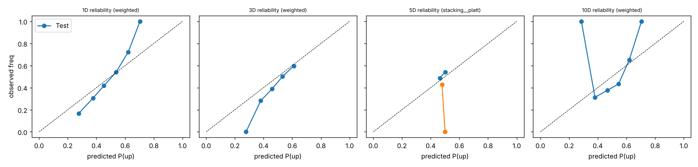
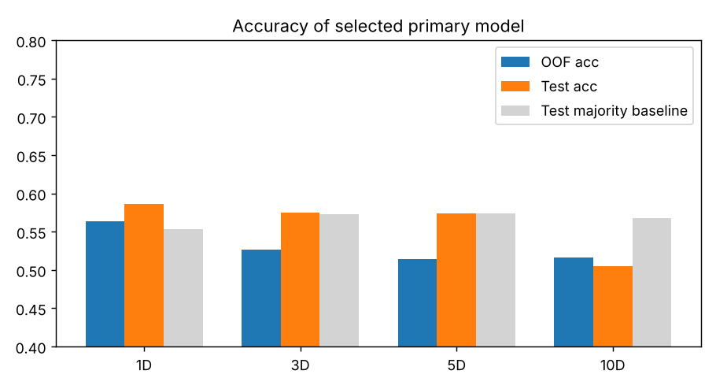
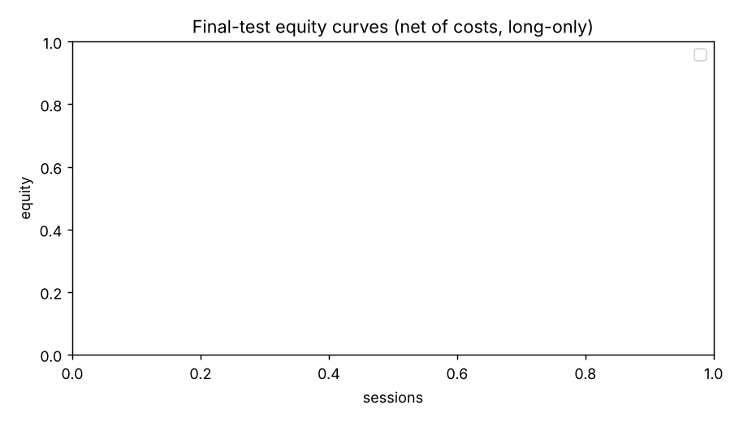

# Multi-horizon calibrated ensemble forecasting on NEPSE floorsheet data

> **Model family: scikit-learn stand-ins.** CatBoost, LightGBM, XGBoost, the Transformer and the TFT were not run; every number below comes from the scikit-learn models listed in section 4. Do not report these results as the named algorithms. Run `FAMILY=native START=6 bash run_pipeline.sh` with the libraries installed to produce them.

## 1. Data validation and cleaning (stages 01–02, 01b)

### 1.1 Floorsheet trades

| File | Size (MB) | CRC ok | SHA-256 | Rows | Dates |
|---|---|---|---|---|---|
| floorsheet_data_part1.zip | 393 | True | `2f0d17037a60c3a0…` | 41,169,555 | 2018-10-01 → 2024-01-31 |
| floorsheet_data_part2.zip | 205 | True | `f1dc39c48ca63786…` | 19,364,427 | 2024-02-01 → 2025-01-28 |
| floorsheet_data_part3.zip | 357 | True | `25f403e6889a11c6…` | 30,514,666 | 2025-02-02 → 2026-11-05 |

Trades parsed: **91,048,648**; kept after cleaning and de-duplication: **91,009,140** (99.957%). Duplicate transaction numbers removed: **39,500** (exact copies 39,500, conflicting 0; by source {'part3->part3': 39500}; months {'202607': 39500}). De-duplication is global: trades are bucketed by the month encoded in the transaction number, so every copy of a transaction lands in the same bucket. Dropped: missing required field 0, non-positive quantity/rate/amount 8, unusable broker id 0, bad date 0. Kept and flagged: 33,758 broker fields with alphanumeric codes (D01; real dealer trades), 102,076 trades from 2018-10-01 to Dec 2018 whose transaction numbers use an older format, 710 rows where amount ≠ quantity × rate by more than NPR 1. `trade_time` is empty in 79.4% of rows, so intraday order is taken from the transaction number. OHLC violations after aggregation: 0; trade counts reconcile with daily aggregates: True. Result: 405,370 symbol-sessions, 655 symbols, 1840 sessions (2018-10-01 → 2026-11-05).

## 2. Modeling panel and targets (stages 03–04)

Universe: {'equity': 369, 'promoter_share': 143, 'debenture_or_fund_series': 112, 'mutual_fund': 30} → ordinary shares only; price source for those: {'ohlcv_adjusted': 287, 'floorsheet': 82}. Bars: {'ohlcv_adjusted': 369216, 'floorsheet_chained': 1522, 'floorsheet_delisted': 34753}; 1,522 floorsheet bars chained onto adjusted series before a symbol's first OHLCV bar. Eligible samples: 305,474 (362 symbols, 1538 sessions, 2018-10-01 → 2026-11-05). Predictors: 53 core (price/return, volatility, candle, trend, oscillators, range, liquidity, floorsheet/broker, NEPSE market) + 7 point-in-time fundamentals; this run used feature set `all` (60 predictors). Floorsheet features are present for 99.2% of samples (by year {'2018': 0.976, '2019': 0.983, '2020': 0.981, '2021': 0.989, '2022': 0.995, '2023': 0.998, '2024': 1.0, '2025': 0.993, '2026': 0.995}) and are left missing, not imputed, where the floorsheet has gaps; fundamentals cover 72.5%. Residual price jumps > 11% (bad prints or unadjusted actions) neutralised on 220 symbol-sessions.

**Thin-floorsheet sessions excluded.** A session is thin when fewer than 50% of its eligible stocks appear in the floorsheet. Runs of at least 5 consecutive thin sessions are dropped from the modelling panel, together with the 19 sessions that follow each run, so that no rolling or sequence window reads a thin session. 277 sessions are thin; 317 are excluded in total. Blocks: 2022-02-10 → 2022-02-28 (13 sessions, buffer to 2022-03-31); 2022-03-31 → 2023-03-30 (238 sessions, buffer to 2023-04-26); 2024-03-17 → 2024-03-31 (10 sessions, buffer to 2024-05-02).

| Horizon | Labeled | Up-rate | Flat outcomes excluded | Mean fwd ret |
|---|---|---|---|---|
| 1d | 286,914 | 46.2% | 6.0% | 0.11% |
| 3d | 299,409 | 46.6% | 1.7% | 0.32% |
| 5d | 300,713 | 47.5% | 1.1% | 0.53% |
| 10d | 301,242 | 48.5% | 0.6% | 1.07% |

## 3. Leakage and split audit (stage 05)

All checks passed: **True**.

| Check | Passed | Detail |
|---|---|---|
| embargo_covers_label_horizon | True | min (val_start - (train_end + 10)) = 16 sessions; embargo=25 |
| validation_blocks_contiguous_non_overlapping | True | blocks tile the development period |
| first_train_window_min_sessions | True | 504 sessions |
| final_test_isolated | True | gap=25 eligible sessions, 26 calendar sessions; test=250 sessions |
| dev_test_row_disjoint | True | dev rows=234,940, test rows=64,387 |
| no_duplicate_symbol_session | True | unique (symbol, session) |
| targets_unavailable_in_last_h_sessions | True | labelled rows in last h sessions: {1: 0, 3: 0, 5: 0, 10: 0} |
| truncation_same_rows | True | 286,755 / 286,755 rows present in both builds |
| features_lookahead_free_truncation_test | True | max |diff|=0.00e+00 (None); NaN-pattern mismatches=0; 60 features x 286,755 rows |
| no_suspicious_feature_target_correlation | True | top |corr| with y_1: [('ret2', -0.037), ('close_vwap', -0.036), ('volratio_1_20', 0.03), ('buyer_top5', 0.028), ('broker_imbalance', 0.028)] |

| Fold | Train sessions | Val sessions | Train dates | Val dates | Train rows | Val rows |
|---|---|---|---|---|---|---|
| 1 | 504 | 91 | 2018-10-01→2021-01-21 | 2021-02-28→2021-07-11 | 72,100 | 15,899 |
| 2 | 595 | 91 | 2018-10-01→2021-06-06 | 2021-07-12→2021-12-01 | 87,712 | 16,414 |
| 3 | 686 | 91 | 2018-10-01→2021-10-24 | 2021-12-02→2023-07-03 | 104,076 | 17,614 |
| 4 | 777 | 91 | 2018-10-01→2023-05-24 | 2023-07-04→2023-11-30 | 121,079 | 19,377 |
| 5 | 868 | 91 | 2018-10-01→2023-10-10 | 2023-12-03→2024-06-05 | 140,052 | 21,519 |
| 6 | 959 | 91 | 2018-10-01→2024-03-10 | 2024-06-06→2024-10-27 | 161,023 | 22,100 |
| 7 | 1050 | 91 | 2018-10-01→2024-09-12 | 2024-10-28→2025-03-23 | 183,145 | 22,083 |
| 8 | 1141 | 97 | 2018-10-01→2025-02-11 | 2025-03-24→2025-08-17 | 205,221 | 23,655 |

Final test: 250 sessions, 2025-10-12 → 2026-11-05 (64,387 rows). Embargo: 25 sessions.

## 4. Models (stages 06–08)

Model family `sklearn`; feature set `all` (60 predictors).

- `hgb`: HistGradientBoostingClassifier (31 leaves, lr 0.05, L2 5, early stopping on a time-ordered hold-out)
- `extratrees`: ExtraTreesClassifier (200 trees, min leaf 100, 30% features, 50% bootstrap)
- `logistic`: Logistic regression (L2, C=0.1) on quantile-normalised inputs
- `mlp`: Multilayer perceptron (128-64, ReLU, Adam, early stopping), one network for all four horizons
- `seq_mlp`: Windowed MLP: 12 key features over the last 20 sessions + the current 60-feature vector, one network for all horizons
- `ranker`: HistGradientBoostingRegressor on within-session return quintiles (pointwise ranker)

## 5. Out-of-fold results (nested region folds 3..8; stages 09–11)

### 1-session horizon (n=123,337, sessions=552)

| Model | Acc | Majority | AUC | LogLoss | Brier | ECE | Acc@conf≥0.70 [95% CI] | Coverage |
|---|---|---|---|---|---|---|---|---|
| avg | 55.6% | 53.6% | 0.572 | 0.6847 | 0.2458 | 0.0286 | 68.6% [64.0%, 72.6%] | 5.02% |
| weighted | 56.3% | 53.6% | 0.580 | 0.6811 | 0.2440 | 0.0117 | 67.9% [54.0%, 82.9%] | 0.32% |
| stacking | 55.9% | 53.6% | 0.572 | 0.6845 | 0.2456 | 0.0265 | 64.2% [56.1%, 75.6%] | 3.11% |
| regime | 56.0% | 53.6% | 0.564 | 0.6903 | 0.2480 | 0.0323 | 60.2% [53.8%, 67.4%] | 7.10% |
| hgb | 56.2% | 53.6% | 0.577 | 0.6844 | 0.2455 | 0.0293 | 66.2% [60.3%, 70.9%] | 6.70% |
| extratrees | 56.6% | 53.6% | 0.581 | 0.6819 | 0.2444 | 0.0230 | 63.6% [0.0%, 70.0%] | 0.01% |
| logistic | 53.8% | 53.6% | 0.543 | 0.6900 | 0.2484 | 0.0235 | 68.6% [61.0%, 74.0%] | 1.44% |
| mlp | 54.1% | 53.6% | 0.550 | 0.7572 | 0.2712 | 0.1267 | 57.4% [55.1%, 59.6%] | 35.94% |
| seq_mlp | 52.8% | 53.6% | 0.539 | 0.9107 | 0.3087 | 0.2175 | 54.5% [52.7%, 56.3%] | 58.98% |
| avg__platt | 55.2% | 53.6% | 0.565 | 0.6854 | 0.2461 | 0.0194 | 60.8% [53.1%, 74.0%] | 1.65% |
| avg__iso | 54.8% | 53.6% | 0.562 | 0.6864 | 0.2464 | 0.0203 | 65.1% [56.6%, 74.8%] | 1.72% |
| weighted__platt | 55.6% | 53.6% | 0.571 | 0.6845 | 0.2457 | 0.0190 | 60.6% [52.5%, 73.4%] | 1.80% |
| weighted__iso | 55.3% | 53.6% | 0.567 | 0.6854 | 0.2460 | 0.0201 | 65.3% [58.6%, 73.9%] | 1.88% |
| stacking__platt | 55.5% | 53.6% | 0.560 | 0.6866 | 0.2467 | 0.0152 | 57.7% [48.3%, 72.5%] | 1.57% |
| stacking__iso | 55.3% | 53.6% | 0.556 | 0.6891 | 0.2472 | 0.0095 | 57.5% [48.8%, 72.6%] | 1.32% |
| regime__platt | 55.3% | 53.6% | 0.551 | 0.6919 | 0.2488 | 0.0285 | 55.7% [45.7%, 69.2%] | 3.60% |
| regime__iso | 55.6% | 53.6% | 0.548 | 0.6927 | 0.2482 | 0.0218 | 58.8% [50.2%, 71.5%] | 3.15% |

### 3-session horizon (n=125,516, sessions=552)

| Model | Acc | Majority | AUC | LogLoss | Brier | ECE | Acc@conf≥0.70 [95% CI] | Coverage |
|---|---|---|---|---|---|---|---|---|
| avg | 53.4% | 52.6% | 0.547 | 0.6979 | 0.2521 | 0.0539 | 60.2% [53.3%, 66.3%] | 4.88% |
| weighted | 52.6% | 52.6% | 0.533 | 0.6919 | 0.2494 | 0.0224 | 75.6% [68.2%, 82.3%] | 0.42% |
| stacking | 53.1% | 52.6% | 0.520 | 0.6952 | 0.2509 | 0.0252 | 60.3% [48.8%, 75.9%] | 1.31% |
| regime | 50.9% | 52.6% | 0.500 | 0.7226 | 0.2622 | 0.0791 | 52.9% [47.0%, 57.7%] | 9.56% |
| hgb | 51.5% | 52.6% | 0.524 | 0.7056 | 0.2557 | 0.0614 | 52.4% [43.7%, 62.0%] | 4.44% |
| extratrees | 52.9% | 52.6% | 0.534 | 0.6904 | 0.2486 | 0.0117 | 85.0% [71.4%, 100.0%] | 0.03% |
| logistic | 52.0% | 52.6% | 0.525 | 0.6968 | 0.2517 | 0.0427 | 64.8% [58.7%, 70.7%] | 1.58% |
| mlp | 52.5% | 52.6% | 0.534 | 0.8479 | 0.2977 | 0.1891 | 54.1% [51.4%, 56.5%] | 51.15% |
| seq_mlp | 52.4% | 52.6% | 0.535 | 1.0189 | 0.3273 | 0.2480 | 53.5% [51.1%, 56.0%] | 65.28% |
| avg__platt | 53.4% | 52.6% | 0.528 | 0.6944 | 0.2505 | 0.0245 | 54.2% [40.8%, 75.1%] | 1.85% |
| avg__iso | 53.2% | 52.6% | 0.524 | 0.6969 | 0.2512 | 0.0238 | 56.5% [46.7%, 70.6%] | 2.64% |
| weighted__platt | 52.9% | 52.6% | 0.512 | 0.6953 | 0.2510 | 0.0244 | 55.3% [41.4%, 76.7%] | 1.55% |
| weighted__iso | 53.1% | 52.6% | 0.508 | 0.6961 | 0.2512 | 0.0188 | 59.3% [48.0%, 77.9%] | 2.09% |
| stacking__platt | 52.9% | 52.6% | 0.497 | 0.6947 | 0.2507 | 0.0173 | 63.0% [0.0%, 100.0%] | 0.11% |
| stacking__iso | 52.6% | 52.6% | 0.494 | 0.6966 | 0.2516 | 0.0145 | 53.5% [39.0%, 78.1%] | 1.79% |
| regime__platt | 52.7% | 52.6% | 0.486 | 0.6959 | 0.2513 | 0.0156 | 53.6% [31.0%, 100.0%] | 0.70% |
| regime__iso | 52.8% | 52.6% | 0.483 | 0.7035 | 0.2534 | 0.0223 | 50.1% [37.0%, 66.7%] | 2.36% |

### 5-session horizon (n=125,802, sessions=552)

| Model | Acc | Majority | AUC | LogLoss | Brier | ECE | Acc@conf≥0.70 [95% CI] | Coverage |
|---|---|---|---|---|---|---|---|---|
| avg | 52.0% | 51.4% | 0.532 | 0.7065 | 0.2562 | 0.0713 | 57.9% [48.4%, 66.7%] | 5.85% |
| weighted | 50.7% | 51.4% | 0.510 | 0.6980 | 0.2524 | 0.0410 | 72.1% [47.1%, 86.0%] | 0.14% |
| stacking | 48.5% | 51.4% | 0.481 | 0.7040 | 0.2552 | 0.0622 | 37.1% [28.0%, 76.6%] | 0.86% |
| regime | 50.1% | 51.4% | 0.491 | 0.7375 | 0.2685 | 0.0999 | 51.8% [43.5%, 58.2%] | 13.91% |
| hgb | 50.2% | 51.4% | 0.505 | 0.7181 | 0.2616 | 0.0879 | 50.0% [39.2%, 61.5%] | 6.84% |
| extratrees | 50.7% | 51.4% | 0.515 | 0.6951 | 0.2510 | 0.0298 | n/a [None, None] | 0.00% |
| logistic | 50.7% | 51.4% | 0.511 | 0.7021 | 0.2543 | 0.0557 | 62.6% [52.3%, 71.0%] | 1.34% |
| mlp | 51.8% | 51.4% | 0.525 | 0.9045 | 0.3125 | 0.2171 | 52.6% [48.7%, 55.9%] | 56.57% |
| seq_mlp | 52.0% | 51.4% | 0.528 | 1.0716 | 0.3373 | 0.2628 | 52.7% [49.9%, 55.4%] | 67.69% |
| avg__platt | 52.1% | 51.4% | 0.494 | 0.7005 | 0.2535 | 0.0321 | 43.9% [29.9%, 72.1%] | 1.30% |
| avg__iso | 52.0% | 51.4% | 0.491 | 0.7012 | 0.2538 | 0.0339 | 45.1% [33.6%, 65.8%] | 1.67% |
| weighted__platt | 51.4% | 51.4% | 0.469 | 0.7005 | 0.2536 | 0.0289 | 21.6% [16.8%, 100.0%] | 0.12% |
| weighted__iso | 49.9% | 51.4% | 0.479 | 0.6992 | 0.2529 | 0.0423 | 33.9% [24.8%, 77.8%] | 0.54% |
| stacking__platt | 51.4% | 51.4% | 0.468 | 0.6967 | 0.2518 | 0.0223 | n/a [None, None] | 0.00% |
| stacking__iso | 51.4% | 51.4% | 0.463 | 0.6987 | 0.2527 | 0.0216 | 36.5% [0.0%, 100.0%] | 0.08% |
| regime__platt | 51.3% | 51.4% | 0.456 | 0.6971 | 0.2520 | 0.0203 | n/a [None, None] | 0.00% |
| regime__iso | 51.4% | 51.4% | 0.464 | 0.6994 | 0.2530 | 0.0255 | n/a [None, None] | 0.00% |

### 10-session horizon (n=126,041, sessions=552)

| Model | Acc | Majority | AUC | LogLoss | Brier | ECE | Acc@conf≥0.70 [95% CI] | Coverage |
|---|---|---|---|---|---|---|---|---|
| avg | 50.9% | 50.0% | 0.518 | 0.7169 | 0.2610 | 0.0951 | 56.7% [43.3%, 68.7%] | 10.72% |
| weighted | 51.7% | 50.0% | 0.517 | 0.7002 | 0.2534 | 0.0436 | 64.4% [20.0%, 91.1%] | 0.94% |
| stacking | 46.8% | 50.0% | 0.459 | 0.7072 | 0.2569 | 0.0768 | 73.2% [19.7%, 89.0%] | 0.53% |
| regime | 46.2% | 50.0% | 0.442 | 0.7874 | 0.2889 | 0.1575 | 44.2% [34.9%, 52.3%] | 19.31% |
| hgb | 53.1% | 50.0% | 0.527 | 0.7212 | 0.2621 | 0.0813 | 50.2% [37.1%, 62.6%] | 15.18% |
| extratrees | 50.4% | 50.0% | 0.511 | 0.6988 | 0.2528 | 0.0477 | 86.0% [30.0%, 100.0%] | 0.03% |
| logistic | 51.2% | 50.0% | 0.514 | 0.7068 | 0.2565 | 0.0651 | 58.1% [42.1%, 71.9%] | 3.64% |
| mlp | 51.5% | 50.0% | 0.528 | 0.9210 | 0.3165 | 0.2288 | 52.6% [47.4%, 57.3%] | 58.96% |
| seq_mlp | 49.8% | 50.0% | 0.499 | 1.0966 | 0.3505 | 0.2807 | 49.9% [46.3%, 53.6%] | 66.53% |
| avg__platt | 46.6% | 50.0% | 0.460 | 0.7123 | 0.2590 | 0.0870 | 41.2% [24.3%, 62.2%] | 3.16% |
| avg__iso | 48.6% | 50.0% | 0.469 | 0.7122 | 0.2585 | 0.0741 | 53.9% [35.6%, 70.4%] | 1.76% |
| weighted__platt | 46.6% | 50.0% | 0.448 | 0.7104 | 0.2584 | 0.0826 | 41.6% [15.3%, 69.0%] | 0.54% |
| weighted__iso | 49.0% | 50.0% | 0.466 | 0.7114 | 0.2588 | 0.0671 | 40.6% [22.7%, 66.0%] | 1.75% |
| stacking__platt | 46.4% | 50.0% | 0.442 | 0.7072 | 0.2569 | 0.0720 | 91.8% [0.0%, 97.8%] | 0.04% |
| stacking__iso | 48.0% | 50.0% | 0.456 | 0.7403 | 0.2649 | 0.0772 | 38.2% [24.4%, 59.2%] | 6.11% |
| regime__platt | 47.6% | 50.0% | 0.470 | 0.7033 | 0.2550 | 0.0660 | 50.0% [0.0%, 100.0%] | 0.00% |
| regime__iso | 48.0% | 50.0% | 0.442 | 0.7923 | 0.2689 | 0.0731 | 30.2% [16.8%, 57.7%] | 4.58% |

## 6. Significance tests (block bootstrap over sessions; DM/HAC; Holm)

Primary candidate per horizon was **chosen on OOF log-loss before the test was touched**:

- **1D** `weighted`: accuracy 56.3% vs majority 53.6% (bootstrap p=0.000); AUC 0.580; ECE 0.0117. At confidence ≥0.70: accuracy 67.9%, coverage 0.32%, n=399; p(acc > majority)=0.024; **p(acc ≥ 0.70)=0.681**.
  - DM log-loss vs climatology: mean Δ=+0.00967, stat=5.46, one-sided p=0.0000, Holm p=0.0000
  - DM log-loss vs best_single: mean Δ=+0.00060, stat=0.60, one-sided p=0.2747, Holm p=1.0000
  - DM log-loss vs avg: mean Δ=+0.00376, stat=1.92, one-sided p=0.0279, Holm p=1.0000
  - Regime split of confident calls: market-up n=432 acc=59.7%; market-down n=1198 acc=56.8%, share of down-calls 75.5%
  - Folds beating majority baseline: 5/6
- **3D** `weighted`: accuracy 52.6% vs majority 52.6% (bootstrap p=0.484); AUC 0.533; ECE 0.0224. At confidence ≥0.70: accuracy 75.6%, coverage 0.42%, n=525; p(acc > majority)=0.000; **p(acc ≥ 0.70)=0.066**.
  - DM log-loss vs climatology: mean Δ=+0.00139, stat=0.43, one-sided p=0.3321, Holm p=1.0000
  - DM log-loss vs best_single: mean Δ=-0.00173, stat=-0.89, one-sided p=0.8135, Holm p=1.0000
  - DM log-loss vs avg: mean Δ=+0.00648, stat=1.85, one-sided p=0.0324, Holm p=1.0000
  - Regime split of confident calls: market-up n=515 acc=70.9%; market-down n=1731 acc=48.4%, share of down-calls 100.0%
  - Folds beating majority baseline: 2/6
- **5D** `stacking__platt`: accuracy 51.4% vs majority 51.4% (bootstrap p=0.532); AUC 0.468; ECE 0.0223. At confidence ≥0.70: accuracy n/a, coverage 0.00%, n=0; p(acc > majority)=n/a; **p(acc ≥ 0.70)=n/a**.
  - DM log-loss vs climatology: mean Δ=-0.00129, stat=-0.34, one-sided p=0.6314, Holm p=1.0000
  - DM log-loss vs best_single: mean Δ=-0.00117, stat=-0.18, one-sided p=0.5709, Holm p=1.0000
  - DM log-loss vs avg: mean Δ=+0.01091, stat=1.08, one-sided p=0.1405, Holm p=1.0000
  - Regime split of confident calls: market-up n=2 acc=100.0%; market-down n=94 acc=35.1%, share of down-calls 100.0%
- **10D** `weighted`: accuracy 51.7% vs majority 50.0% (bootstrap p=0.235); AUC 0.517; ECE 0.0436. At confidence ≥0.70: accuracy 64.4%, coverage 0.94%, n=1,186; p(acc > majority)=0.306; **p(acc ≥ 0.70)=0.641**.
  - DM log-loss vs climatology: mean Δ=-0.00308, stat=-0.31, one-sided p=0.6205, Holm p=1.0000
  - DM log-loss vs best_single: mean Δ=-0.00154, stat=-0.41, one-sided p=0.6576, Holm p=1.0000
  - DM log-loss vs avg: mean Δ=+0.01717, stat=2.54, one-sided p=0.0056, Holm p=0.4449
  - Regime split of confident calls: market-up n=2488 acc=55.8%; market-down n=5217 acc=29.7%, share of down-calls 100.0%
  - Folds beating majority baseline: 0/6

### Ranker (pointwise HistGradientBoosting, scikit-learn stand-in) – cross-sectional experiment

| Horizon | Mean rank-IC | IC t (HAC) | Top-bottom quintile spread | Top-decile up-rate |
|---|---|---|---|---|
| 1D | 0.2138 | 32.55 | 1.13% | 58.2% |
| 3D | 0.1862 | 21.18 | 1.67% | 57.3% |
| 5D | 0.1517 | 14.03 | 1.65% | 55.5% |
| 10D | 0.1157 | 7.14 | 1.70% | 53.8% |

## 7. Untouched final test (stage 12)

Dates 2025-10-12 → 2026-11-05. Forced re-runs recorded in lock: 0.

| Horizon | Primary | Acc [95% CI] | Majority | AUC | LogLoss | ECE | Acc@≥0.70 | Coverage | n@≥0.70 | p(acc≥0.70) |
|---|---|---|---|---|---|---|---|---|---|---|
| 1D | weighted | 58.6% [56.5%, 60.6%] | 55.3% | 0.604 | 0.6738 | 0.0315 | 83.9% | 0.30% | 180 | 0.172 |
| 3D | weighted | 57.5% [54.8%, 60.4%] | 57.3% | 0.585 | 0.6795 | 0.0569 | 100.0% | 0.00% | 2 | 0.000 |
| 5D | stacking__platt | 57.3% [50.1%, 64.5%] | 57.3% | 0.473 | 0.6882 | 0.0526 | n/a | 0.00% | 0 | n/a |
| 10D | weighted | 50.5% [44.6%, 56.2%] | 56.8% | 0.588 | 0.6923 | 0.0998 | 60.0% | 0.01% | 5 | 0.615 |

## 8. Backtest (stage 13, final test, net of costs)

Costs/side: {'commission': 0.0036, 'sebon': 0.00015, 'slippage': 0.001}; CGT 7.5%; long-only; entry next-session open.

| Horizon | Thr | Signals | Filled | Trades | Mean net/trade [95% CI] | Hit rate | p(≤0) | Placebo mean | p vs placebo | Sharpe | MaxDD | Cum ret |
|---|---|---|---|---|---|---|---|---|---|---|---|---|
| 1D | 0.60 | 412 | 389 | 389 | -0.20% [-0.50%, 0.10%] | 41.9% | 0.918 | -0.71% | 0.000 | -0.40 | -16.6% | -9.4% |
| 1D | 0.70 | 5 | 5 | – | too few trades | | | | | | | |
| 3D | 0.60 | 241 | 239 | 239 | 0.45% [-0.34%, 1.50%] | 50.6% | 0.139 | -0.60% | 0.000 | 1.51 | -5.0% | 19.7% |
| 3D | 0.70 | 0 | 0 | – | too few trades | | | | | | | |
| 5D | 0.60 | 0 | 0 | – | too few trades | | | | | | | |
| 5D | 0.70 | 0 | 0 | – | too few trades | | | | | | | |
| 10D | 0.60 | 1061 | 960 | 960 | 0.38% [-1.29%, 1.78%] | 50.1% | 0.345 | -0.40% | 0.000 | -1.81 | -19.7% | -11.1% |
| 10D | 0.70 | 3 | 3 | – | too few trades | | | | | | | |

## 9. What the evidence supports

- **1D:** overall test accuracy 58.6% – statistically above the majority baseline (55.3%). At ≥0.70 confidence accuracy was 83.9% on 0.30% of cases (n=180); the 95% CI is [50.0%, 85.1%], so a true accuracy of 70% is NOT statistically supported (lower bound below 70%).
- **3D:** overall test accuracy 57.5% – NOT statistically distinguishable from the majority baseline (57.3%). At ≥0.70 confidence accuracy was 100.0% on 0.00% of cases (n=2); the 95% CI is [100.0%, 100.0%], so a true accuracy of 70% is not assessable: fewer than 100 calls.
- **5D:** overall test accuracy 57.3% – NOT statistically distinguishable from the majority baseline (57.3%). No predictions reached 0.70 confidence.
- **10D:** overall test accuracy 50.5% – NOT statistically distinguishable from the majority baseline (56.8%). At ≥0.70 confidence accuracy was 60.0% on 0.01% of cases (n=5); the 95% CI is [0.0%, 100.0%], so a true accuracy of 70% is not assessable: fewer than 100 calls.

70% is therefore a *selective-prediction operating point* (accuracy conditional on confidence ≥ 0.70 with the stated coverage), not a model-wide accuracy. Calibration (ECE) shows whether stated confidences are honest.

## 10. Limitations

- Daily aggregation hides intraday dynamics; no order-book data.
- The floorsheet is largely missing for Feb 2022 – Mar 2023 and Mar 2024; broker features are missing there (prices come from the adjusted OHLCV table).
- Fundamental publication dates are approximated as quarter end + 45 days; a sensitivity check with a longer lag is advisable.
- Overlapping labels (h>1) are handled by block bootstrap and HAC tests but reduce the effective sample size.
- Corporate-action adjustment is heuristic (jumps > 11%); dividends are not modelled.
- Long-only execution at the next open assumes fills; thin names may fill worse than the 10 bp slippage assumed.
- A single 250-session test window covers one market regime; repeated forward evaluation is recommended before any deployment claim.
- Results from a smoke-test run (stand-in models) must not be cited as results of the named algorithms.